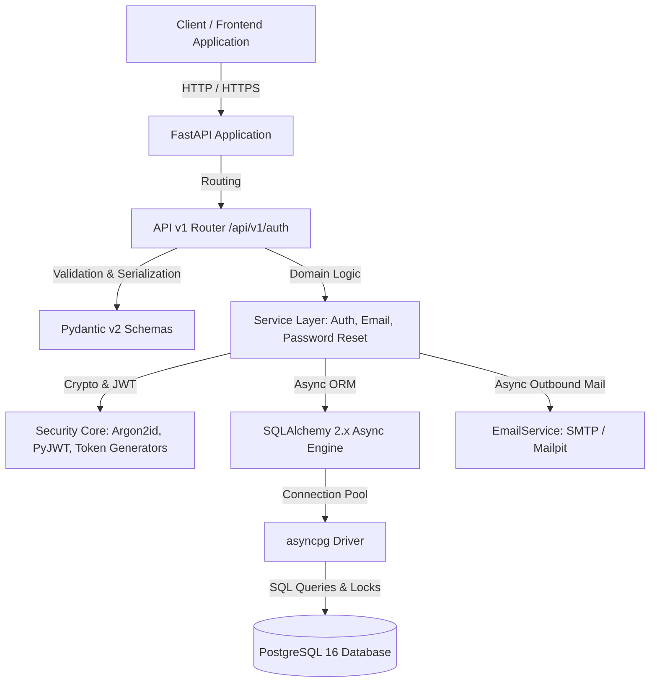
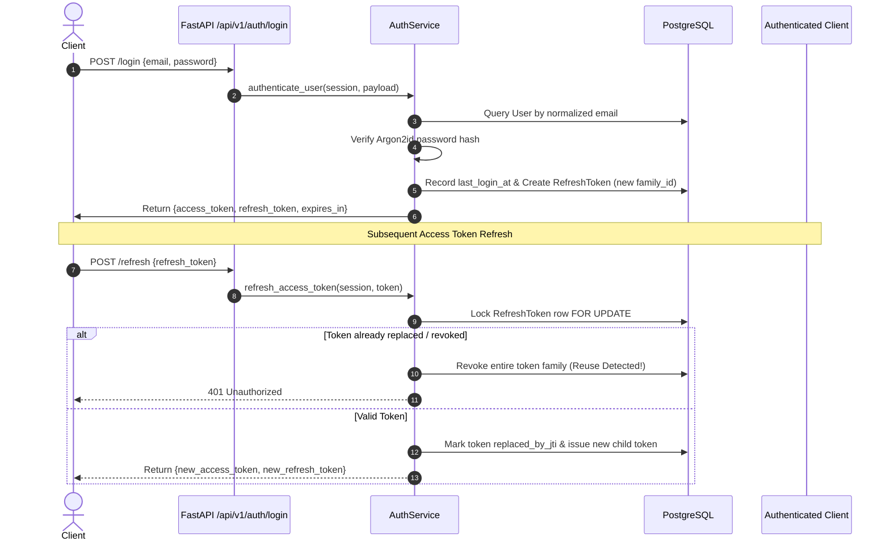

# Document Processing Platform

A modern, high-performance, and secure asynchronous backend for the Document Processing Platform.

## Current Phase

**Phase 3.4 — Document Listing, Search, Filtering & Metadata Management (Completed)**

The platform provides a production-grade authentication engine (Phase 2), a decoupled storage abstraction (Phase 3.1), a robust document metadata database foundation (Phase 3.2), a hardened document upload subsystem (Phase 3.3), and a comprehensive document discovery and metadata management engine (Phase 3.4):
- **Authenticated Document Listing:** `GET /api/v1/documents` endpoint enforcing strict JWT Bearer authentication, querying PostgreSQL with SQL-level owner isolation (`Document.user_id == current_user.id`) to guarantee tenants can never view foreign records.
- **SQL-Level Pagination:** Configurable `limit` (default 20, range 1–100) and `offset` (default 0, ge 0) applied directly in PostgreSQL queries via `LIMIT` and `OFFSET`, paired with an exact count query matching identical filter conditions.
- **Deterministic Multi-Column Sorting:** Controlled sorting by `created_at`, `updated_at`, `original_filename`, or `size_bytes` in either `asc` or `desc` order, stabilized by a secondary tie-breaker on document UUID (`Document.id`) to prevent pagination jitter.
- **Precise Metadata Filtering:** Exact content-type filtering (`content_type`), ISO 8601 timezone-aware creation date boundaries (`created_after`, `created_before`) with chronological validation, and zero naive-datetime leakage.
- **Safe Substring Filename Search (`q`):** Parameterized case-insensitive substring search (`ILIKE`) with automatic escaping of SQL LIKE wildcard metacharacters (`%`, `_`, and `\`), preventing SQL injection and pattern manipulation.
- **Single Document Metadata Retrieval:** `GET /api/v1/documents/{document_id}` endpoint validating UUID paths, querying exclusively within the caller's ownership scope, and returning uniform HTTP 404 responses for nonexistent and cross-user IDs alike (anti-enumeration / IDOR defense).
- **Zero Storage Leakage:** Listing and detail queries execute purely against PostgreSQL metadata without opening file descriptors, reading storage bytes, or exposing internal `storage_key` values or server directory structures.
- **Authenticated Secure Document Upload:** `POST /api/v1/documents` endpoint enforcing JWT Bearer authentication, accepting multipart form uploads under the `file` field with strict client-tamper protection (`user_id` derived exclusively from server authentication context).
- **Strict Filename Validation & Normalization:** Unicode NFC normalization, null byte (`\0`, `%00`), path separator (`/`, `\\`), colon (`:`), traversal (`..`), control character, and length boundary (1–255 chars) validation. Missing stems or extensions are rejected.
- **Content-Type Signature Detection (Magic Bytes):** Initial byte signature identification for PDF (`%PDF-`), JPEG (`\xFF\xD8\xFF`), PNG (`\x89PNG\r\n\x1a\n`), TIFF (`II*\x00` and `MM\x00*`), and WebP (`RIFF...WEBP`), cross-validated against allowed filename extensions to prevent naive extension spoofing. Magic-byte checks identify formats by header signature but do not perform deep structural parsing, decompression, or malware/antivirus scanning (deferred to Phase 4 OCR processing).
- **Bounded-Memory Streaming & Quota Enforcement:** Asynchronous generator streaming in chunks (default 1MB buffer) directly to `StorageBackend` without buffering entire payloads in memory; configurable size quota via `MAX_UPLOAD_SIZE_BYTES` (default 20MB) with early stream termination, consistent HTTP 413 error mapping across all chunk boundaries, and incremental SHA-256 calculation.
- **Cancellation-Safe Consistency & Storage Compensation:** Persistence to PostgreSQL `documents` table tied to authenticated `user.id`. In the event of database transaction failure or task cancellation, two-phase compensation triggers an immediate physical unlink via `storage.delete(storage_key, missing_ok=True)` to prevent orphaned files, while verifying database state to ensure committed records are never severed from their storage objects.
- **Document Domain Model:** Full SQLAlchemy `Document` model tracking logical identity, owner reference, opaque storage key, display filename, content type, 64-bit size, and SHA-256 checksum.
- **Database-Level Integrity Constraints:** Native PostgreSQL check constraints validating 32-character lowercase hex storage keys, 64-character SHA-256 checksums, and non-negative file sizing.
- **Optimized B-tree Indexing:** Composite index `(user_id, created_at)` optimizing owner queries and ordered pagination without duplicate standalone index overhead.
- **User Deletion Protection:** Foreign key `ON DELETE RESTRICT` with `passive_deletes="all"` preventing parent user deletion from orphaning external physical files on storage and suppressing in-memory foreign key nullification.
- **Alembic Migration 0010:** Clean, bidirectional migration with verified upgrade, downgrade, and re-upgrade cycles against live PostgreSQL.
- **Abstract Storage Backend:** Clean asynchronous contracts (`StorageBackend`, `StoredObjectReader`) independent of web frameworks, HTTP uploads, and database models.
- **Local Filesystem Implementation:** `LocalStorage` backend with cryptographically secure, opaque 32-hex keys partitioned across 2-level subdirectories (`ab/cd/abcdef...`).
- **Atomic File Writes & Cleanup:** Temporary staging writes with automatic rollback/cleanup on stream failures; atomic publication via hard link (`os.link`) with fail-closed protection on unsupported filesystems.
- **Full Authentication System:** Case-insensitive identity, Argon2id hashing, dual-token JWT, refresh token rotation & reuse detection, email verification, and password reset.

*Note: Document download, deletion, OCR processing pipelines, async workers, and AI features belong to subsequent Phase 3 and Phase 4 sub-phases (starting with Phase 3.5).*

---

## Technology Stack

- **Language:** Python 3.12+
- **API Framework:** FastAPI
- **ASGI Server:** Uvicorn
- **Database:** PostgreSQL 16
- **ORM / Query Engine:** SQLAlchemy 2.x (Async)
- **Database Driver:** asyncpg
- **Migrations:** Alembic (Async)
- **Password Hashing:** Argon2id (`argon2-cffi`)
- **Token Signing:** PyJWT (HS256 with algorithm pinning)
- **Settings:** Pydantic Settings & Pydantic v2
- **Testing:** Pytest, pytest-asyncio, HTTPX
- **Linter & Formatter:** Ruff
- **Type Checking:** Mypy (Strict mode)
- **Containerization:** Docker & Docker Compose (non-root `appuser`)
- **Local Mail Testing:** Mailpit
- **Continuous Integration:** GitHub Actions

---

## Architecture Overview



### Module Organization

```text
.
├── .github/
│   └── workflows/
│       └── ci.yml             # GitHub Actions CI workflow (lint, typecheck, migrations, tests)
├── alembic/                   # Database migrations configuration & versions
│   ├── versions/              # Reversible migration scripts (0001 through 0010)
│   ├── env.py                 # Alembic async environment
│   └── script.py.mako         # Migration script template
├── app/
│   ├── __init__.py
│   ├── main.py                # FastAPI entrypoint, OpenAPI metadata, lifespan & error handlers
│   ├── api/
│   │   ├── __init__.py
│   │   ├── deps.py            # Reusable dependencies (get_current_user, HTTPBearer)
│   │   ├── health.py          # Liveness (/health) & Readiness (/ready) probes
│   │   └── v1/
│   │       ├── __init__.py    # Version 1 router aggregator
│   │       ├── auth.py        # 10 Authentication endpoints (register, login, refresh, me, reset, etc.)
│   │       └── documents.py   # Document upload endpoint (POST /api/v1/documents)
│   ├── core/
│   │   ├── __init__.py
│   │   ├── config.py          # Pydantic Settings with production guardrails
│   │   ├── logging.py         # Structured JSON logging & secret sanitization
│   │   └── security.py        # Argon2id hashing, JWT encode/decode, token entropy generators
│   ├── db/
│   │   ├── __init__.py
│   │   ├── base.py            # DeclarativeBase with custom table naming
│   │   ├── session.py         # Async engine, connection pool & explicit transaction strategy
│   │   └── models/            # SQLAlchemy ORM models
│   │       ├── user.py        # User entity with auth_version and passive_deletes="all"
│   │       ├── role.py        # Role, Permission, UserRole, RolePermission
│   │       ├── refresh_token.py # RefreshToken with family_id, jti, revocation
│   │       ├── email_verification_token.py # EmailVerificationToken with SHA-256 hash
│   │       ├── password_reset_token.py     # PasswordResetToken with SHA-256 hash
│   │       └── document.py    # Document entity with storage_key, checksum, size, metadata
│   ├── schemas/
│   │   ├── __init__.py
│   │   ├── auth.py            # Pydantic request/response schemas with extra='forbid'
│   │   └── document.py        # DocumentResponse schema with extra='forbid' and UUID/datetime serialization
│   ├── services/
│   │   ├── __init__.py
│   │   ├── auth.py            # Registration, login, token rotation, profile updates
│   │   ├── document.py        # Document upload orchestration, bounded streaming & compensation
│   │   ├── document_validation.py # Filename sanitization, magic-byte detection, extension matching
│   │   ├── email.py           # Email service with mock transport and async SMTP dispatch
│   │   ├── email_verification.py # Token issuance, concurrent resend locks, verification
│   │   └── password_reset.py  # Anti-enumeration request, atomic confirm, session revocation
│   └── storage/               # Decoupled file storage foundation
│       ├── __init__.py        # Factory, caching & FastAPI dependency (get_storage)
│       ├── base.py            # Abstract StorageBackend & StoredObjectReader interfaces
│       ├── exceptions.py      # Structured storage exception hierarchy
│       ├── local.py           # LocalStorage backend with atomic writes & chunked streaming
│       └── types.py           # StorageMetadata, StoredObject, BinaryStream protocols
├── docs/                      # Architectural documentation & audit reports
│   ├── phase-2-final-review.md
│   ├── storage-architecture.md # Storage architecture, security & streaming contracts (Phase 3.1)
│   └── document-architecture.md # Document model, database integrity & upload architecture (Phase 3.2 - 3.3)
├── tests/
│   ├── __init__.py
│   ├── conftest.py            # Pytest fixtures, test database engine & HTTPX async clients
│   ├── unit/                  # Unit tests (schemas, config, tokens, models, JWT, OpenAPI, validation, service)
│   └── integration/           # Integration tests against live PostgreSQL & storage (auth, storage, documents, upload)
├── .env.example               # Reference configuration with development defaults
├── Dockerfile                 # Production multi-stage Dockerfile running as appuser
├── docker-compose.yml         # Local stack orchestration (API, PostgreSQL, Mailpit)
├── pyproject.toml             # Project metadata, Ruff, Mypy, and Pytest configuration
└── README.md                  # Comprehensive developer documentation
```

---

## Authentication Lifecycle & Security Architecture

### 1. Registration Flow
- Client submits `POST /api/v1/auth/register` with `email`, `username`, and `password`.
- Password is validated against policy (8-128 chars, uppercase, lowercase, digit, special char, no null bytes) and hashed via Argon2id.
- Case-insensitive uniqueness check prevents duplicates.
- Default `user` role is assigned transactionally in the same database transaction.
- An initial high-entropy email verification token is generated, hashed with SHA-256, and persisted.
- A verification email is queued/dispatched containing `#token=<RAW_TOKEN>`.

### 2. Login & Token Rotation Flow



### 3. Session Invalidation via `auth_version`
In standard stateless JWT architectures, access tokens remain valid until expiration even after logout or password change. To guarantee instant global revocation without expensive per-request token blacklists:
1. Every `User` record holds an integer column: `auth_version` (default: 0).
2. Every access token embeds this claim: `payload["auth_version"] = user.auth_version`.
3. The `get_current_user` dependency compares the JWT's `auth_version` against the live database record.
4. When a user confirms a password reset:
   - `user.password_hash` is updated to the new Argon2id hash.
   - `user.auth_version` is atomically incremented by 1 (`user.auth_version += 1`).
   - All active refresh token families for that user are revoked in PostgreSQL.
   - Outstanding reset tokens are invalidated.
   - The transaction commits atomically.
5. All previously issued access tokens become invalid immediately on the very next request.

### 4. URL Hash Fragment Strategy (`#token=...`)
Both Email Verification and Password Reset tokens use URL fragments:
- **Format:** `https://frontend.example.com/reset-password#token=<RAW_TOKEN>`
- **Security Rationale:** Browsers do not send URI fragments to web servers in HTTP request lines, preventing raw tokens from leaking into web server access logs, reverse proxy logs, or `Referer` headers.
- **Frontend Contract:**
  1. Frontend single-page application reads the token via `window.location.hash`.
  2. Frontend immediately wipes the hash from the browser address bar using `history.replaceState(null, "", window.location.pathname)`.
  3. Frontend sends the raw token in the JSON request body (`{"token": "<RAW_TOKEN>"}`).

---

## Local Development Setup

### Prerequisites
- Python 3.12+
- Docker & Docker Compose (or a local PostgreSQL 16 instance)

### 1. Virtual Environment Setup

```bash
# Create virtual environment
python -m venv .venv

# Activate virtual environment
# Windows (PowerShell):
.venv\Scripts\Activate.ps1
# Linux / macOS:
source .venv/bin/activate

# Upgrade pip and install package in editable mode with development dependencies
pip install --upgrade pip
pip install -e ".[dev]"
```

### 2. Configure Environment

```bash
# Copy example configuration
cp .env.example .env
```

Ensure `.env` matches your local PostgreSQL configuration. For local testing, default settings work directly with Docker Compose.

### 3. Start Infrastructure (PostgreSQL & Mailpit)

```bash
# Start PostgreSQL database and Mailpit email server in detached mode
docker compose up -d postgres mailpit

# View service status
docker compose ps
```

- **PostgreSQL:** `localhost:5432` (or configured port)
- **Mailpit SMTP:** `localhost:1025`
- **Mailpit Web UI:** `http://localhost:8025` (preview sent verification and reset emails)

### 4. Run Database Migrations

```bash
# Upgrade database to latest revision
alembic upgrade head

# Verify current revision
alembic current
# Expected output: 0010_create_documents_table (head)
```

### 5. Start the Application

```bash
# Start FastAPI application with live reload
uvicorn app.main:app --host 0.0.0.0 --port 8000 --reload
```

Interactive API documentation:
- **Swagger UI:** `http://localhost:8000/docs`
- **ReDoc:** `http://localhost:8000/redoc`
- **OpenAPI JSON:** `http://localhost:8000/openapi.json`
- *Note: Swagger UI has `persistAuthorization: true` configured. Click "Authorize", paste an access token, and it will persist across page refreshes.*

---

## Code Quality & Automated Validation

The project enforces strict code style, static typing, and test suites matching the CI pipeline.

```bash
# 1. Run Ruff linter
ruff check .

# 2. Check code formatting
ruff format --check .

# 3. Run Mypy strict type checking
mypy app tests

# 4. Run full test suite (533 tests: 525 passed, 8 skipped on Windows)
pytest -v

# 5. Run unit tests only
pytest tests/unit -v

# 6. Run integration tests against PostgreSQL
pytest tests/integration -v
```

---

## Environment Variables Reference

| Variable | Type | Default | Description |
| :--- | :--- | :--- | :--- |
| `APP_NAME` | string | `Document Processing Platform` | Application display name |
| `APP_ENV` | enum | `development` | Environment (`development`, `testing`, `staging`, `production`) |
| `DEBUG` | boolean | `false` | Debug mode (must be `false` in production) |
| `LOG_LEVEL` | enum | `INFO` | Log severity (`DEBUG`, `INFO`, `WARNING`, `ERROR`, `CRITICAL`) |
| `API_HOST` | string | `0.0.0.0` | API bind address |
| `API_PORT` | integer | `8000` | API bind port |
| `DATABASE_URL` | string | *(dev URL)* | Async connection string (`postgresql+asyncpg://...`) |
| `DB_POOL_SIZE` | integer | `10` | Base database connection pool size |
| `DB_MAX_OVERFLOW` | integer | `20` | Max overflow connections beyond pool size |
| `DB_POOL_TIMEOUT` | float | `30.0` | Connection acquisition timeout in seconds |
| `JWT_SECRET_KEY` | string | *(dev key)* | Signing secret (min 32 chars in production) |
| `JWT_ALGORITHM` | string | `HS256` | Cryptographic signing algorithm (pinned) |
| `JWT_ACCESS_TOKEN_EXPIRE_MINUTES` | integer | `30` | Access token lifetime in minutes |
| `JWT_REFRESH_TOKEN_EXPIRE_DAYS` | integer | `7` | Refresh token lifetime in days |
| `JWT_ISSUER` | string | `docplatform` | Expected JWT `iss` claim |
| `JWT_AUDIENCE` | string | `docplatform-api` | Expected JWT `aud` claim |
| `EMAIL_VERIFICATION_TOKEN_EXPIRE_MINUTES` | integer | `30` | Verification token lifetime in minutes |
| `PASSWORD_RESET_TOKEN_EXPIRE_MINUTES` | integer | `30` | Password reset token lifetime in minutes |
| `SMTP_HOST` | string | `localhost` | Outbound SMTP relay host |
| `SMTP_PORT` | integer | `1025` | Outbound SMTP relay port |
| `SMTP_USERNAME` | string \| null | `null` | Optional SMTP authentication username |
| `SMTP_PASSWORD` | string \| null | `null` | Optional SMTP authentication password |
| `SMTP_USE_TLS` | boolean | `false` | Enable STARTTLS (mutually exclusive with SSL) |
| `SMTP_USE_SSL` | boolean | `false` | Enable implicit SSL (mutually exclusive with TLS) |
| `SMTP_FROM_EMAIL` | string | `noreply@docplatform.local` | From address for outgoing system emails |
| `SMTP_FROM_NAME` | string | `Document Processing Platform` | Sender name in email headers |
| `FRONTEND_BASE_URL` | string | `http://localhost:3000` | Public frontend URL for email link generation |
| `STORAGE_BACKEND` | enum | `local` | Storage backend driver (`local`; future: `s3`) |
| `STORAGE_LOCAL_ROOT` | string | `./storage_data` | Root filesystem directory for local file persistence |
| `STORAGE_CHUNK_SIZE` | integer | `1048576` | Streaming I/O chunk size in bytes (64KB - 16MB) |
| `MAX_UPLOAD_SIZE_BYTES` | integer | `20971520` | Maximum allowed document upload size in bytes (1B - 500MB) |

---

## Storage Architecture & Foundation (Phase 3.1)

The platform incorporates a decoupled, production-grade file storage architecture located under `app/storage/`.

### Architecture & Abstraction
- **Abstract Interface:** `StorageBackend` (`app/storage/base.py`) defines neutral asynchronous methods: `save()`, `open()`, `delete()`, `exists()`, `get_metadata()`, `generate_key()`, `initialize()`, and `close()`.
- **Zero Web / DB Coupling:** The storage layer operates independently from FastAPI `UploadFile`, SQLAlchemy models, or document business rules. Future backends (e.g. AWS S3 / MinIO) can be introduced without altering application code.
- **FastAPI Dependency Injection:** Accessible via `get_storage` dependency (`app.storage.get_storage`), referencing the initialized singleton created during application lifespan (`app.state.storage`).

### Local Filesystem Backend (`LocalStorage`)
- **Opaque Storage Keys:** User-provided filenames are never written directly to the filesystem. Instead, cryptographically random 32-character hexadecimal keys (`secrets.token_hex(16)`) are generated.
- **Directory Partitioning:** Keys are stored in a two-tier directory tree: `<root>/ab/cd/abcdef...` (256 × 256 = 65,536 subdirectories), preventing filesystem inode lookup degradation.
- **Bounded-Memory Streaming:** Both writes and reads are chunked (default 1MB buffer), offloading blocking disk I/O to worker threads via `asyncio.to_thread`.
- **Atomic Writes & Rollback:** Uploads are written to staging files (`.tmp_<random>_<name>`) in the target directory and published atomically via hard link (`os.link`), preventing overwrite races and failing closed with `StorageUnsupportedFilesystemError` on filesystems without hard-link support. If an error occurs mid-stream, partial files are immediately purged and `StorageWriteError` is raised.
- **Safe Directory Pruning:** Deletion of the last file in a partition automatically cleans up empty parent directories up to the storage root.

### Storage Security Guarantees
- **Path Traversal & Absolute Path Rejection:** Storage keys are strictly validated against `^[a-f0-9]{32}$`. Any key with `..`, `\0`, or path separators is rejected with `StorageInvalidKeyError`.
- **Symlink Escape Detection:** Resolved paths are verified to reside strictly under `STORAGE_LOCAL_ROOT` with `is_relative_to`. Any symlink in the hierarchy raises `StorageSecurityError`.
- **Information Disclosure Protection:** Low-level filesystem errors are captured and translated into high-level storage exceptions without exposing absolute server paths.
- **Fail-Fast Startup Probe:** At startup, `initialize()` creates the storage root and verifies write permissions with a temporary probe file (`.probe_<token>`). Inability to write halts application startup immediately with `StoragePermissionError`.

### Docker Persistence & Local Development
- **Docker Compose:** Persistent named volume `storage_data` is mounted to `/app/storage_data` in the API container:
  ```yaml
  volumes:
    - storage_data:/app/storage_data
  ```
- **Non-Root Ownership:** The `Dockerfile` provisions `/app/storage_data` owned by `appuser:appgroup` before dropping privileges. Data safely persists across container rebuilds.
- **Local Dev Directory:** Locally, files default to `./storage_data/`.
- **Resetting Local Storage:** To reset local storage during development without touching databases:
  ```bash
  # Delete local directory:
  rm -rf ./storage_data/*
  # In Docker:
  docker compose down -v  # wipes both database and storage volumes
  ```

---

## Security Policies & Controls

### Implemented Controls
1. **Password Storage:** Argon2id with recommended parameters (`m=65536, t=3, p=4`). Passwords are never logged or stored in plaintext.
2. **Access Token Lifespan:** Short-lived (default 30 min) JWTs with pinned `HS256` algorithm. Strict validation of `sub`, `exp`, `iat`, `type`, `iss`, `aud`, and `auth_version`.
3. **Refresh Token Isolation:** Refresh tokens are stateful and stored as database session records. Reusing an old token immediately revokes all tokens within that family.
4. **Token Type Segregation:** Access tokens cannot be submitted to `/refresh` or `/logout`; refresh tokens cannot be used as Bearer access tokens.
5. **Anti-Enumeration:** Uniform 200 OK responses with generic text for password reset requests whether an email exists, is inactive, or is nonexistent. Constant-time dummy Argon2id hashing prevents timing oracle attacks.
6. **Concurrent Safety:** All token state mutations use PostgreSQL `SELECT ... FOR UPDATE` row locks to prevent race conditions during token consumption and resend requests.
7. **Production Guardrails:** `Settings` strictly blocks startup if `DEBUG=True`, default dev database URLs, default JWT secrets, unencrypted authenticated SMTP, or localhost frontend URLs are used in `production`.
8. **File Signature Identification & Allowlist:** Magic byte inspection prevents basic extension masquerading (e.g. executable `MZ` or HTML scripts renamed to `.pdf` or `.png`) by validating initial header bytes against an allowlist. It does not perform deep file structure parsing, semantic validation, or antivirus/malware scanning. Protection against malicious or polyglot files embedded within valid formats is deferred to the Phase 4 processing and parsing pipeline.

### Deferred Risks & Limitations
- **Rate Limiting:** Distributed rate limiting (e.g. Redis-backed token bucket) is deferred. The application currently relies on upstream reverse proxies (NGINX, Cloudflare, AWS WAF) for volumetric DDoS and brute-force throttling on `/login`, `/register`, and `/password-reset/request`.
- **Background Worker Queue:** Transaction commits occur before SMTP dispatch, with async non-blocking I/O via `asyncio.to_thread`. A dedicated distributed message queue (e.g. Celery / ARQ / RabbitMQ) is planned for Phase 4 (OCR processing pipelines).

---

## Phase 3 Roadmap & Scope Boundaries

Phase 3 establishes the document storage and management subsystem across distinct sub-phases:
- **Phase 3.1 — Storage Architecture & Local Filesystem Foundation (Completed)**: Decoupled `StorageBackend` abstraction, `LocalStorage` backend with two-level prefix partitioning, atomic hard-link publication (`os.link`), bounded-memory streaming, and path traversal security.
- **Phase 3.2 — Document Data Model & Database Integrity (Completed)**: SQLAlchemy `Document` model, PostgreSQL integrity constraints, composite index `(user_id, created_at)`, user deletion protection (`ON DELETE RESTRICT`, `passive_deletes="all"`), and Alembic migration `0010_create_documents_table`.
- **Phase 3.3 — Secure Document Upload (Completed)**: Streaming upload endpoints (`POST /api/v1/documents`), magic-byte MIME validation (PDF, JPEG, PNG, TIFF, WebP), file size quota enforcement (`MAX_UPLOAD_SIZE_BYTES`), transactional PostgreSQL persistence, and automatic storage cleanup compensation upon database commit failure.
- **Phase 3.4 — Document Listing & Management (Next)**: Metadata listing (`GET /api/v1/documents`), single document lookup (`GET /api/v1/documents/{id}`), pagination, and ownership verification.
- **Phase 3.5 — Secure Download & Coordinated Deletion**: Streaming download endpoints (`GET /api/v1/documents/{id}/download`), Range headers, and coordinated two-phase deletion (atomic physical file unlink via `StorageBackend` followed by database metadata record removal).
