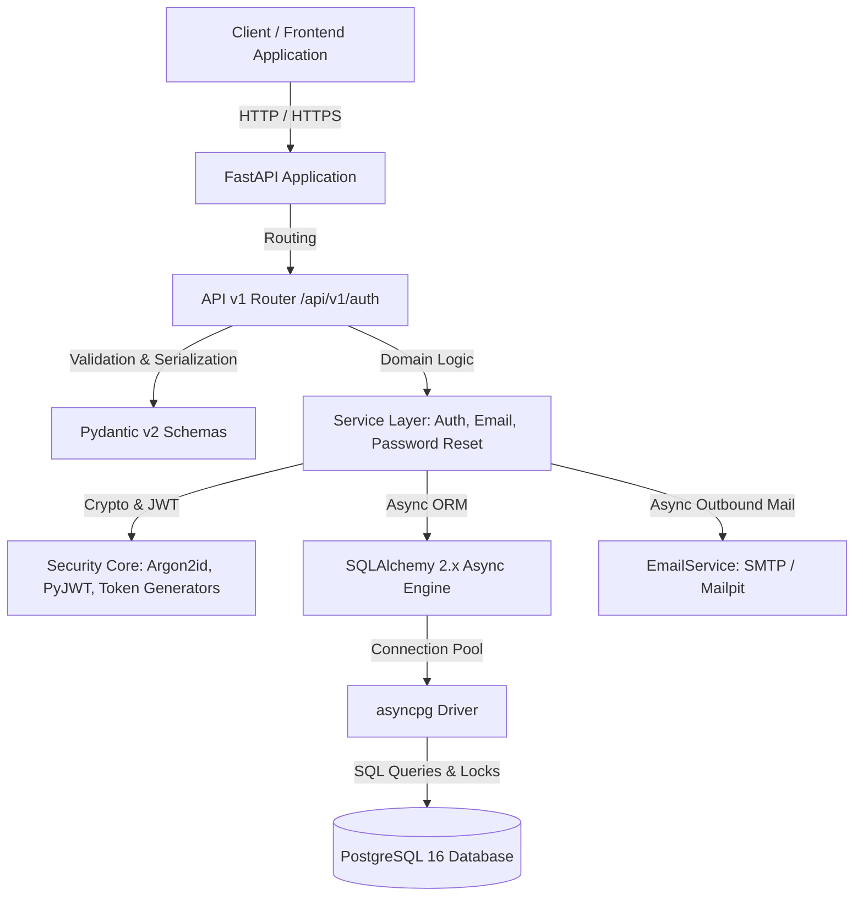
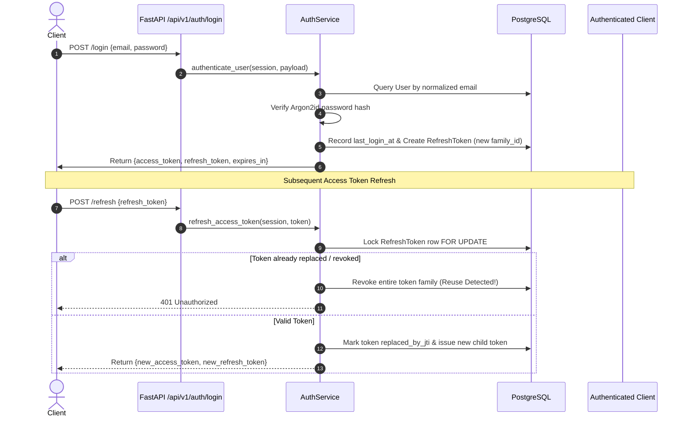

# Document Processing Platform

A modern, high-performance, and secure asynchronous backend for the Document Processing Platform.

## Current Phase

**Phase 2 — Authentication & Users (Completed)**

This repository provides a production-conscious authentication and user management foundation built with FastAPI, SQLAlchemy 2.x (async), PostgreSQL, Alembic, Argon2id, and JWTs:
- **Case-Insensitive Identity & Unique Constraints:** Email and username uniqueness guaranteed at the database level with functional indexes.
- **Argon2id Password Security:** Memory-hard hashing using `argon2-cffi` (`m=65536, t=3, p=4`), Unicode normalization (NFKC), and strict password policy.
- **Role & Permission Foundation:** Pre-seeded roles (`admin`, `user`) and transactional default role assignment during registration.
- **Dual-Token JWT Architecture:** Short-lived access tokens (HS256 with strict algorithm pinning) paired with persistent refresh tokens in PostgreSQL.
- **Refresh Token Rotation & Reuse Detection:** Single-use rotation with token family tracking; compromised families are instantly and automatically revoked.
- **Instant Global Session Invalidation:** Incrementing persistent `auth_version` on [User](app/db/models/user.py) terminates all existing access tokens live upon password reset.
- **Email Verification & Password Reset:** High-entropy single-use tokens hashed with SHA-256 before storage; delivered safely via URL hash fragments (`#token=...`).
- **Anti-Enumeration Protection:** Generic uniform responses and constant-time dummy password hashing for nonexistent and inactive accounts.
- **Strict Pydantic Validation:** All request and response schemas forbid extra fields, sanitize outputs, and protect internal identifiers and hashes.
- **Operational Health Checks:** Liveness (`/health`) and timeout-shielded PostgreSQL Readiness (`/ready`).

*Note: Document storage, OCR processing pipelines, async workers, search, and AI features belong to future phases (Phase 3+) and are not implemented in Phase 2.*

---

## Technology Stack

- **Language:** Python 3.12+
- **API Framework:** FastAPI
- **ASGI Server:** Uvicorn
- **Database:** PostgreSQL 16
- **ORM / Query Engine:** SQLAlchemy 2.x (Async)
- **Database Driver:** asyncpg
- **Migrations:** Alembic (Async)
- **Password Hashing:** Argon2id (`argon2-cffi`)
- **Token Signing:** PyJWT (HS256 with algorithm pinning)
- **Settings:** Pydantic Settings & Pydantic v2
- **Testing:** Pytest, pytest-asyncio, HTTPX
- **Linter & Formatter:** Ruff
- **Type Checking:** Mypy (Strict mode)
- **Containerization:** Docker & Docker Compose (non-root `appuser`)
- **Local Mail Testing:** Mailpit
- **Continuous Integration:** GitHub Actions

---

## Architecture Overview



### Module Organization

```text
.
├── .github/
│   └── workflows/
│       └── ci.yml             # GitHub Actions CI workflow (lint, typecheck, migrations, tests)
├── alembic/                   # Database migrations configuration & versions
│   ├── versions/              # Reversible migration scripts (0001 through 0009)
│   ├── env.py                 # Alembic async environment
│   └── script.py.mako         # Migration script template
├── app/
│   ├── __init__.py
│   ├── main.py                # FastAPI entrypoint, OpenAPI metadata, lifespan & error handlers
│   ├── api/
│   │   ├── __init__.py
│   │   ├── deps.py            # Reusable dependencies (get_current_user, HTTPBearer)
│   │   ├── health.py          # Liveness (/health) & Readiness (/ready) probes
│   │   └── v1/
│   │       ├── __init__.py    # Version 1 router aggregator
│   │       └── auth.py        # 10 Authentication endpoints (register, login, refresh, me, reset, etc.)
│   ├── core/
│   │   ├── __init__.py
│   │   ├── config.py          # Pydantic Settings with production guardrails
│   │   ├── logging.py         # Structured JSON logging & secret sanitization
│   │   └── security.py        # Argon2id hashing, JWT encode/decode, token entropy generators
│   ├── db/
│   │   ├── __init__.py
│   │   ├── base.py            # DeclarativeBase with custom table naming
│   │   ├── session.py         # Async engine, connection pool & explicit transaction strategy
│   │   └── models/            # SQLAlchemy ORM models
│   │       ├── user.py        # User entity with auth_version
│   │       ├── role.py        # Role, Permission, UserRole, RolePermission
│   │       ├── refresh_token.py # RefreshToken with family_id, jti, revocation
│   │       ├── email_verification_token.py # EmailVerificationToken with SHA-256 hash
│   │       └── password_reset_token.py     # PasswordResetToken with SHA-256 hash
│   ├── schemas/
│   │   ├── __init__.py
│   │   └── auth.py            # Pydantic request/response schemas with extra='forbid'
│   └── services/
│       ├── __init__.py
│       ├── auth.py            # Registration, login, token rotation, profile updates
│       ├── email.py           # Email service with mock transport and async SMTP dispatch
│       ├── email_verification.py # Token issuance, concurrent resend locks, verification
│       └── password_reset.py  # Anti-enumeration request, atomic confirm, session revocation
├── docs/                      # Architectural documentation & audit reports
│   └── phase-2-final-review.md
├── tests/
│   ├── __init__.py
│   ├── conftest.py            # Pytest fixtures, test database engine & HTTPX async clients
│   ├── unit/                  # Unit tests (schemas, config, tokens, models, JWT, OpenAPI)
│   └── integration/           # Integration tests against live PostgreSQL
├── .env.example               # Reference configuration with development defaults
├── Dockerfile                 # Production multi-stage Dockerfile running as appuser
├── docker-compose.yml         # Local stack orchestration (API, PostgreSQL, Mailpit)
├── pyproject.toml             # Project metadata, Ruff, Mypy, and Pytest configuration
└── README.md                  # Comprehensive developer documentation
```

---

## Authentication Lifecycle & Security Architecture

### 1. Registration Flow
- Client submits `POST /api/v1/auth/register` with `email`, `username`, and `password`.
- Password is validated against policy (8-128 chars, uppercase, lowercase, digit, special char, no null bytes) and hashed via Argon2id.
- Case-insensitive uniqueness check prevents duplicates.
- Default `user` role is assigned transactionally in the same database transaction.
- An initial high-entropy email verification token is generated, hashed with SHA-256, and persisted.
- A verification email is queued/dispatched containing `#token=<RAW_TOKEN>`.

### 2. Login & Token Rotation Flow



### 3. Session Invalidation via `auth_version`
In standard stateless JWT architectures, access tokens remain valid until expiration even after logout or password change. To guarantee instant global revocation without expensive per-request token blacklists:
1. Every `User` record holds an integer column: `auth_version` (default: 0).
2. Every access token embeds this claim: `payload["auth_version"] = user.auth_version`.
3. The `get_current_user` dependency compares the JWT's `auth_version` against the live database record.
4. When a user confirms a password reset:
   - `user.password_hash` is updated to the new Argon2id hash.
   - `user.auth_version` is atomically incremented by 1 (`user.auth_version += 1`).
   - All active refresh token families for that user are revoked in PostgreSQL.
   - Outstanding reset tokens are invalidated.
   - The transaction commits atomically.
5. All previously issued access tokens become invalid immediately on the very next request.

### 4. URL Hash Fragment Strategy (`#token=...`)
Both Email Verification and Password Reset tokens use URL fragments:
- **Format:** `https://frontend.example.com/reset-password#token=<RAW_TOKEN>`
- **Security Rationale:** Browsers do not send URI fragments to web servers in HTTP request lines, preventing raw tokens from leaking into web server access logs, reverse proxy logs, or `Referer` headers.
- **Frontend Contract:**
  1. Frontend single-page application reads the token via `window.location.hash`.
  2. Frontend immediately wipes the hash from the browser address bar using `history.replaceState(null, "", window.location.pathname)`.
  3. Frontend sends the raw token in the JSON request body (`{"token": "<RAW_TOKEN>"}`).

---

## Local Development Setup

### Prerequisites
- Python 3.12+
- Docker & Docker Compose (or a local PostgreSQL 16 instance)

### 1. Virtual Environment Setup

```bash
# Create virtual environment
python -m venv .venv

# Activate virtual environment
# Windows (PowerShell):
.venv\Scripts\Activate.ps1
# Linux / macOS:
source .venv/bin/activate

# Upgrade pip and install package in editable mode with development dependencies
pip install --upgrade pip
pip install -e ".[dev]"
```

### 2. Configure Environment

```bash
# Copy example configuration
cp .env.example .env
```

Ensure `.env` matches your local PostgreSQL configuration. For local testing, default settings work directly with Docker Compose.

### 3. Start Infrastructure (PostgreSQL & Mailpit)

```bash
# Start PostgreSQL database and Mailpit email server in detached mode
docker compose up -d postgres mailpit

# View service status
docker compose ps
```

- **PostgreSQL:** `localhost:5432` (or configured port)
- **Mailpit SMTP:** `localhost:1025`
- **Mailpit Web UI:** `http://localhost:8025` (preview sent verification and reset emails)

### 4. Run Database Migrations

```bash
# Upgrade database to latest revision
alembic upgrade head

# Verify current revision
alembic current
# Expected output: 0009_password_reset_tokens (head)
```

### 5. Start the Application

```bash
# Start FastAPI application with live reload
uvicorn app.main:app --host 0.0.0.0 --port 8000 --reload
```

Interactive API documentation:
- **Swagger UI:** `http://localhost:8000/docs`
- **ReDoc:** `http://localhost:8000/redoc`
- **OpenAPI JSON:** `http://localhost:8000/openapi.json`
- *Note: Swagger UI has `persistAuthorization: true` configured. Click "Authorize", paste an access token, and it will persist across page refreshes.*

---

## Code Quality & Automated Validation

The project enforces strict code style, static typing, and test suites matching the CI pipeline.

```bash
# 1. Run Ruff linter
ruff check .

# 2. Check code formatting
ruff format --check .

# 3. Run Mypy strict type checking
mypy app tests

# 4. Run full test suite (322 tests)
pytest -v

# 5. Run unit tests only
pytest tests/unit -v

# 6. Run integration tests against PostgreSQL
pytest tests/integration -v
```

---

## Environment Variables Reference

| Variable | Type | Default | Description |
| :--- | :--- | :--- | :--- |
| `APP_NAME` | string | `Document Processing Platform` | Application display name |
| `APP_ENV` | enum | `development` | Environment (`development`, `testing`, `staging`, `production`) |
| `DEBUG` | boolean | `false` | Debug mode (must be `false` in production) |
| `LOG_LEVEL` | enum | `INFO` | Log severity (`DEBUG`, `INFO`, `WARNING`, `ERROR`, `CRITICAL`) |
| `API_HOST` | string | `0.0.0.0` | API bind address |
| `API_PORT` | integer | `8000` | API bind port |
| `DATABASE_URL` | string | *(dev URL)* | Async connection string (`postgresql+asyncpg://...`) |
| `DB_POOL_SIZE` | integer | `10` | Base database connection pool size |
| `DB_MAX_OVERFLOW` | integer | `20` | Max overflow connections beyond pool size |
| `DB_POOL_TIMEOUT` | float | `30.0` | Connection acquisition timeout in seconds |
| `JWT_SECRET_KEY` | string | *(dev key)* | Signing secret (min 32 chars in production) |
| `JWT_ALGORITHM` | string | `HS256` | Cryptographic signing algorithm (pinned) |
| `JWT_ACCESS_TOKEN_EXPIRE_MINUTES` | integer | `30` | Access token lifetime in minutes |
| `JWT_REFRESH_TOKEN_EXPIRE_DAYS` | integer | `7` | Refresh token lifetime in days |
| `JWT_ISSUER` | string | `docplatform` | Expected JWT `iss` claim |
| `JWT_AUDIENCE` | string | `docplatform-api` | Expected JWT `aud` claim |
| `EMAIL_VERIFICATION_TOKEN_EXPIRE_MINUTES` | integer | `30` | Verification token lifetime in minutes |
| `PASSWORD_RESET_TOKEN_EXPIRE_MINUTES` | integer | `30` | Password reset token lifetime in minutes |
| `SMTP_HOST` | string | `localhost` | Outbound SMTP relay host |
| `SMTP_PORT` | integer | `1025` | Outbound SMTP relay port |
| `SMTP_USERNAME` | string \| null | `null` | Optional SMTP authentication username |
| `SMTP_PASSWORD` | string \| null | `null` | Optional SMTP authentication password |
| `SMTP_USE_TLS` | boolean | `false` | Enable STARTTLS (mutually exclusive with SSL) |
| `SMTP_USE_SSL` | boolean | `false` | Enable implicit SSL (mutually exclusive with TLS) |
| `SMTP_FROM_EMAIL` | string | `noreply@docplatform.local` | From address for outgoing system emails |
| `SMTP_FROM_NAME` | string | `Document Processing Platform` | Sender name in email headers |
| `FRONTEND_BASE_URL` | string | `http://localhost:3000` | Public frontend URL for email link generation |

---

## Security Policies & Controls

### Implemented Controls
1. **Password Storage:** Argon2id with recommended parameters (`m=65536, t=3, p=4`). Passwords are never logged or stored in plaintext.
2. **Access Token Lifespan:** Short-lived (default 30 min) JWTs with pinned `HS256` algorithm. Strict validation of `sub`, `exp`, `iat`, `type`, `iss`, `aud`, and `auth_version`.
3. **Refresh Token Isolation:** Refresh tokens are stateful and stored as database session records. Reusing an old token immediately revokes all tokens within that family.
4. **Token Type Segregation:** Access tokens cannot be submitted to `/refresh` or `/logout`; refresh tokens cannot be used as Bearer access tokens.
5. **Anti-Enumeration:** Uniform 200 OK responses with generic text for password reset requests whether an email exists, is inactive, or is nonexistent. Constant-time dummy Argon2id hashing prevents timing oracle attacks.
6. **Concurrent Safety:** All token state mutations use PostgreSQL `SELECT ... FOR UPDATE` row locks to prevent race conditions during token consumption and resend requests.
7. **Production Guardrails:** `Settings` strictly blocks startup if `DEBUG=True`, default dev database URLs, default JWT secrets, unencrypted authenticated SMTP, or localhost frontend URLs are used in `production`.

### Deferred Risks & Limitations
- **Rate Limiting:** Distributed rate limiting (e.g. Redis-backed token bucket) is deferred. The application currently relies on upstream reverse proxies (NGINX, Cloudflare, AWS WAF) for volumetric DDoS and brute-force throttling on `/login`, `/register`, and `/password-reset/request`.
- **Background Worker Queue:** Transaction commits occur before SMTP dispatch, with async non-blocking I/O via `asyncio.to_thread`. A dedicated distributed message queue (e.g. Celery / ARQ / RabbitMQ) is planned for Phase 3.
