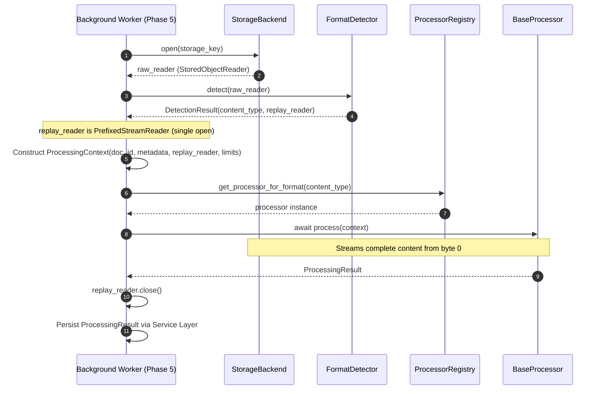
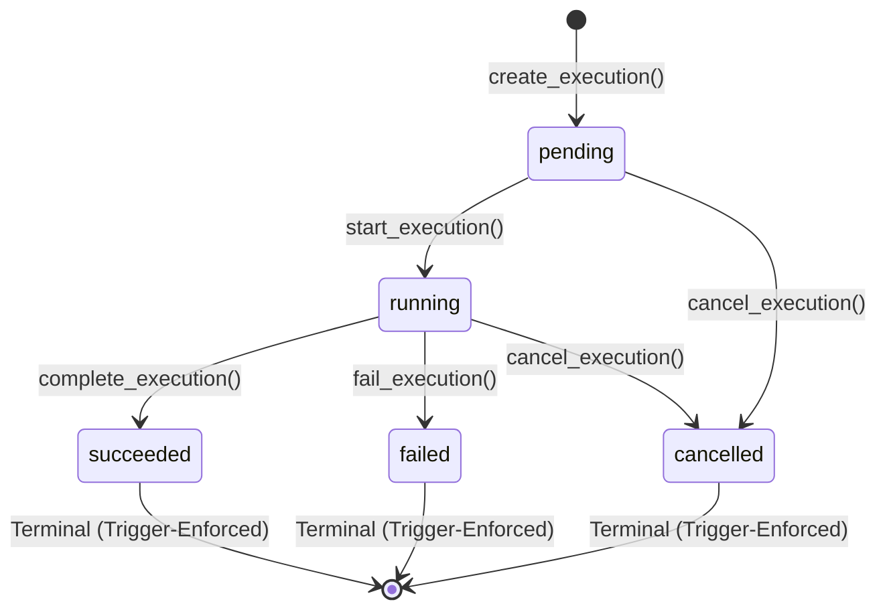

# Processing Architecture & Foundation (Phase 4.1)

## 1. Overview and Scope

The processing architecture establishes a decoupled, extensible, secure, and independently testable execution engine for the Document Processing Platform.

Phase 4.1 defines the contracts, data structures, processor interfaces, registry, format detection foundation, stream replay adapters, and exception hierarchy without implementing concrete format parsers (PDF, image, OCR), database persistence, or asynchronous worker infrastructure.

### Architectural Responsibilities
- **Decoupled Orchestration**: The processing subsystem operates independently of FastAPI request objects, HTTP transports, and PostgreSQL ORM sessions.
- **Strict Typing and Contracts**: Clear boundaries for processor inputs (`ProcessingContext`), outputs (`ProcessingResult`), metadata (`ProcessorMetadata`), and limits (`ProcessingLimits`).
- **Deterministic Resolution**: Centralized registry (`ProcessorRegistry`) mapping normalized media types to registered processor implementations without silent fallback or ambiguity.
- **Storage Neutrality**: Content access occurs via `StoredObjectReader` streams rather than direct filesystem paths or backend-specific assumptions.
- **Streaming Integrity**: Forward-only stream inspection uses `PrefixedStreamReader` to replay inspected magic bytes, guaranteeing downstream processors receive the entire document starting at byte zero without reopening storage.
- **Future Worker Compatibility**: Complete parity between in-process synchronous/asynchronous execution and future Phase 5 distributed task workers (Celery, RQ, etc.).

---

## 2. Package Structure

The subsystem resides in `app/processing/`:

```text
app/processing/
    __init__.py          # Public subsystem exports
    base.py              # BaseProcessor abstract base class
    context.py           # Immutable ProcessingContext
    detector.py          # FormatDetector and DetectionResult contract
    exceptions.py        # Exception hierarchy with safe error codes & path sanitization
    registry.py          # ProcessorRegistry and format mapping
    result.py            # Versioned ProcessingResult and PageResult schemas
    stream.py            # PrefixedStreamReader forward-only stream replay adapter
    types.py             # Enums, ProcessorMetadata, and ProcessingLimits
```

---

## 3. Core Subsystem Contracts

### A. Processor Interface (`BaseProcessor`)
Every document processor inherits from `BaseProcessor` and implements:
1. `metadata`: Exposes `name`, `version`, `supported_formats` (tuple of MIME strings), and `capabilities` (`ProcessingCapability` enums).
2. `process(context: ProcessingContext) -> ProcessingResult`: Asynchronous execution method.

```python
class BaseProcessor(ABC):
    @property
    @abstractmethod
    def metadata(self) -> ProcessorMetadata: ...

    @abstractmethod
    async def process(self, context: ProcessingContext) -> ProcessingResult: ...
```

#### Storage and Seekability Notice
`StoredObjectReader` provides forward-only streaming (`chunks()` / `sync_chunks()`). It is **not seekable**. Future format parsers requiring random file access (such as PyMuPDF or Pillow in Phase 4.3/4.4) must utilize a bounded temporary file adapter or memory buffer up to `context.limits.max_input_size_bytes` rather than assuming random-access streaming from the storage reader.

### B. Processing Context (`ProcessingContext`)
An immutable, validated data structure passed to processors:
- `document_id: uuid.UUID`
- `original_filename: str`
- `content_type: str`
- `size_bytes: int`
- `sha256: str`
- `reader: StoredObjectReader`
- `limits: ProcessingLimits`
- `correlation_id: str`
- `metadata: Mapping[str, Any]` (wrapped in `MappingProxyType`)

**Immutability and Statefulness Rules:**
- Shallow immutability: The top-level `metadata` mapping is wrapped in `MappingProxyType`. Nested mutable collections within metadata (if any) are not recursively deep-frozen.
- Reader statefulness: `reader` conforms to `StoredObjectReader`, which is an inherently stateful streaming construct (file descriptors, internal buffers, `.closed` flag).
- Stream integrity: When format detection precedes processing, `reader` must be a replay-capable reader (`PrefixedStreamReader`) returned by `FormatDetector.detect()`, guaranteeing the document can be read from byte zero.
- Security: Does not contain user credentials, tokens, or ORM sessions, and never duplicates full document bytes in memory.

### C. Processing Result (`ProcessingResult`)
A versioned, Pydantic-validated outcome:
- `processor_name: str`
- `processor_version: str`
- `schema_version: str` (default: `"1.0.0"`)
- `status: ProcessingStatus` (`SUCCESS`, `PARTIAL_SUCCESS`, `FAILED`)
- `metadata: dict[str, Any]` (validated JSON-serializable document metadata)
- `extracted_text: str | None` (aggregated plain text)
- `pages: list[PageResult] | None` (structured per-page output with dimensions and text)
- `warnings: list[str]` (sanitized warnings)
- `statistics: dict[str, Any]` (validated JSON-serializable execution metrics)
- `error_code: str | None` / `error_message: str | None`

**Security & Serialization Rules:**
- JSON integrity & recursion safety: `metadata` and `statistics` (as well as `PageResult.metadata`) validate that all nested values consist strictly of standard JSON-serializable primitives (strings, finite numbers, booleans, null, lists, dicts with string keys).
  - **Nesting Ceiling (`MAX_JSON_NESTING_DEPTH = 64`)**: Recursion depth is capped at 64 levels. Any payload exceeding 64 levels is deterministically rejected with `ValueError` to prevent interpreter call-stack exhaustion (`RecursionError`). Document processing metadata trees (PDF geometries, OCR bounding boxes, OCR words/lines) typically span 2-6 levels, making 64 levels generous while guaranteeing safety.
  - **Strict Float Compliance**: Non-finite floats (`NaN`, `+Infinity`, `-Infinity`) are forbidden under standard RFC 8259 JSON and are strictly rejected.
  - **Active-Path Cycle Interception**: Circular structures (direct `d["self"] = d` and indirect `a -> b -> a`) are intercepted by tracking object IDs in the active recursion call stack, raising a clean validation error without infinite loops.
  - **DAG Preservation**: Legitimate repeated references in sibling branches (directed acyclic graphs) are safely accepted and serialize deterministically.
  - **Zero Caller Mutation**: The validation traversal inspects data read-only without modifying caller objects.
- Path scrubbing: Internal filesystem paths (Windows drive letters, UNC shares, POSIX directories, relative storage paths) are automatically sanitized to `[redacted_path]`.
- Failure consistency: `status == FAILED` strictly requires a non-null `error_code`.
- Strict typing: Extra or non-serializable fields are forbidden (`extra="forbid"`).

### D. Processor Registry (`ProcessorRegistry`)
Maintains mappings between processor identifiers, MIME types, and instances:
- Resolves processors deterministically via `get_processor_for_format(content_type)`.
- Rejects duplicate names or format collisions unless `allow_replace=True` is explicitly specified.
- Raises `UnsupportedDocumentFormatError` for unknown media types.
- Provides test isolation via instance creation or `reset_default_registry()`.

### E. Format Detection & Stream Replay (`FormatDetector` & `PrefixedStreamReader`)
`FormatDetector` verifies stored object integrity and MIME signatures at processing time using initial stream magic bytes (via `detect_content_type`), protecting against corrupted, truncated, or extension-spoofed files before invocation of format engines.

```python
class DetectionResult(NamedTuple):
    content_type: str
    reader: StoredObjectReader


class FormatDetector:
    async def detect(self, reader: StoredObjectReader) -> DetectionResult: ...
    def detect_sync(self, reader: StoredObjectReader) -> DetectionResult: ...
```

**Stream Replay Architecture (`PrefixedStreamReader`):**
1. The detector inspects up to `buffer_size` bytes (default 64 KiB) from the storage reader.
2. The read prefix is encapsulated into a `PrefixedStreamReader` that wraps the original `StoredObjectReader`.
3. Downstream processors consume `reader.read()`, `reader.read_sync()`, `reader.chunks()`, or `reader.sync_chunks()`, which seamlessly replays the prefix bytes first before streaming the remainder of the underlying file.
4. **Single-Open Guarantee**: The underlying storage object is opened exactly once.
5. **Bounded Memory**: Only the initial prefix buffer is held in memory, never the full document.

#### Streaming Consumer Lifecycle & Resource Management
Both `PrefixedStreamReader` and underlying storage readers manage finite operating system resources (file descriptors, sockets). Because generators execute their `finally: self.close()` block only upon exhaustion or explicit closure, callers must adhere to deterministic lifecycle contracts:

1. **Complete Iteration (Natural Exhaustion):**
   When `chunks()` or `sync_chunks()` is consumed to completion (`EOF`), the generator loop exits naturally and runs `finally: self.close()`. The reader and underlying descriptors are closed automatically and idempotently.

2. **Early Termination (Aborted Iteration):**
   Consumers **must not** rely on CPython garbage collection or reference-counting to finalize unexhausted generators. If a loop is exited early (e.g., via `break` or an exception), the generator remains paused at `yield` until finalized:
   - **Synchronous Streams (`sync_chunks`):**
     ```python
     # Option A: contextlib.closing context manager (Recommended)
     with contextlib.closing(reader.sync_chunks(chunk_size=1024)) as stream:
         for chunk in stream:
             if condition:
                 break  # Exiting block calls stream.close() -> reader.close()

     # Option B: Reader context manager
     with reader:
         for chunk in reader.sync_chunks():
             if condition:
                 break  # Exiting block calls reader.close()

     # Option C: Explicit finally block
     stream = reader.sync_chunks()
     try:
         for chunk in stream:
             if condition:
                 break
     finally:
         stream.close()
     ```
   - **Asynchronous Streams (`chunks`):**
     ```python
     # Option A: contextlib.aclosing context manager (Recommended PEP 525)
     async with contextlib.aclosing(reader.chunks(chunk_size=1024)) as stream:
         async for chunk in stream:
             if condition:
                 break  # Exiting block calls await stream.aclose() -> reader.close()

     # Option B: Reader async context manager
     async with reader:
         async for chunk in reader.chunks():
             if condition:
                 break  # Exiting block calls reader.close()

     # Option C: Explicit aclose()
     stream = reader.chunks()
     try:
         async for chunk in stream:
             if condition:
                 break
     finally:
         await stream.aclose()
     ```

---

## 4. Configuration and Resource Limits

Defined in `app/core/config.py` and wrapped in `ProcessingLimits`:

| Setting | Default | Range | Purpose |
| :--- | :--- | :--- | :--- |
| `MAX_UPLOAD_SIZE_BYTES` | 20 MiB (`20971520`) | 1 B – 500 MiB | API ingress acceptance threshold |
| `PROCESSING_MAX_INPUT_SIZE_BYTES` | 20 MiB (`20971520`) | 1 B – 500 MiB | Downstream processing eligibility limit |
| `PROCESSING_TIMEOUT_SECONDS` | `60.0` | 1.0 s – 3600.0 s | Execution timeout threshold |
| `PROCESSING_MAX_TEXT_SIZE_BYTES` | 10 MiB (`10485760`) | 1 KiB – 100 MiB | Maximum aggregate extracted plain text size |
| `PROCESSING_MAX_PAGES` | `1000` | 1 – 50,000 | Maximum page count allowed in a single document |
| `PROCESSING_MAX_IMAGE_PIXELS` | 50 MP (`50000000`) | 1,000 – 500 MP | Maximum allowed image dimension pixel count |
| `PROCESSING_MAX_METADATA_SIZE_BYTES` | 64 KiB (`65536`) | 1 KiB – 1 MiB | Maximum size of extracted metadata payload |

### Note on Decoupled Upload vs. Processing Limits
`MAX_UPLOAD_SIZE_BYTES` and `PROCESSING_MAX_INPUT_SIZE_BYTES` are intentionally decoupled:
- **Upload Limit**: Dictates whether an untrusted file is accepted and written to storage at API ingress.
- **Processing Limit**: Dictates whether an accepted, stored file is eligible for CPU/memory-intensive parsing and extraction.
- **Tiered Policy**: A platform configuration may permit uploading 50 MiB archives for raw storage while capping OCR/processing to 20 MiB documents. A document can thus be stored successfully in Phase 3.3 but rejected at processing time if it exceeds `PROCESSING_MAX_INPUT_SIZE_BYTES`.

---

## 5. Exception Hierarchy

All processing exceptions inherit from `ProcessingError` and provide a stable machine-readable `code`:

```text
ProcessingError (PROCESSING_ERROR)
├── ProcessorConfigurationError (PROCESSOR_CONFIGURATION_ERROR)
├── ProcessorRegistrationError (PROCESSOR_REGISTRATION_ERROR)
├── UnsupportedDocumentFormatError (UNSUPPORTED_DOCUMENT_FORMAT)
├── InvalidProcessingInputError (INVALID_PROCESSING_INPUT)
├── CorruptedDocumentError (CORRUPTED_DOCUMENT)
├── EncryptedDocumentError (ENCRYPTED_DOCUMENT)
├── ProcessingResourceLimitExceededError (PROCESSING_RESOURCE_LIMIT_EXCEEDED)
│   └── ProcessorTimeoutError (PROCESSOR_TIMEOUT)
└── ProcessorExecutionError (PROCESSOR_EXECUTION_ERROR)
```

Public exception messages and warnings are scrubbed using `_sanitize_message` to eliminate Windows drive letters, UNC shares, POSIX directories, and relative storage paths, replacing them with `[redacted_path]`.

---

## 6. Phase 5 Background Worker Compatibility

The processing architecture is intentionally decoupled from scheduling mechanisms. When background workers (Celery, Redis, etc.) are introduced in Phase 5, the execution sequence will be identical:



Zero modifications to `BaseProcessor`, `ProcessingContext`, or `ProcessingResult` will be required when introducing distributed background workers.

---

## 7. Phase 4.2 — Processing Persistence Model & Lifecycle State Machine

Phase 4.2 connects the independent processing domain to PostgreSQL persistence without introducing coupling to FastAPI, HTTP endpoints, or background-job infrastructure.

### A. Persistence Model (`DocumentProcessing`)

The `DocumentProcessing` entity (`app/db/models/document_processing.py`) maps to the `document_processings` table:

| Column | Type | Constraints / Nullability | Description |
|---|---|---|---|
| `id` | UUID | PRIMARY KEY, NOT NULL | Unique processing execution identifier |
| `document_id` | UUID | FOREIGN KEY -> `documents.id` ON DELETE CASCADE, NOT NULL | Target document |
| `processor_name` | VARCHAR(64) | NOT NULL | Identifier of the processor engine |
| `processor_version` | VARCHAR(32) | NOT NULL | Semantic version of the processor engine |
| `status` | VARCHAR(20) | NOT NULL, DEFAULT `'pending'` | Current lifecycle status |
| `input_sha256` | VARCHAR(64) | NOT NULL | Hex SHA-256 hash of input document content |
| `result_schema_version` | VARCHAR(32) | NULL | Version string of the persisted result schema |
| `result` | JSONB | NULL | Structured processing result dictionary |
| `error_code` | VARCHAR(64) | NULL | Machine-readable failure classification code |
| `error_message` | TEXT | NULL | Path-scrubbed diagnostic error or cancel reason |
| `created_at` | TIMESTAMPTZ | NOT NULL, server_default=now() | Execution creation timestamp |
| `started_at` | TIMESTAMPTZ | NULL | Timestamp when execution entered `running` |
| `finished_at` | TIMESTAMPTZ | NULL | Timestamp when execution reached terminal state |
| `updated_at` | TIMESTAMPTZ | NOT NULL, server_default=now() | Row last modification timestamp |

### B. Database Constraints, Indexes & Invariant Enforcement

1. **Check Constraints**:
   - `ck_document_processings_status`: `status IN ('pending', 'running', 'succeeded', 'failed', 'cancelled')`
   - `ck_document_processings_input_sha256`: `input_sha256 ~ '^[0-9a-f]{64}$'`
   - `ck_document_processings_timestamps`: `started_at IS NULL OR finished_at IS NULL OR finished_at >= started_at`
   - `ck_document_processings_status_fields` (updated in migration `0013_doc_proc_transitions`):
     - `pending`: `started_at IS NULL AND finished_at IS NULL AND result IS NULL AND error_code IS NULL`
     - `running`: `started_at IS NOT NULL AND finished_at IS NULL AND result IS NULL AND error_code IS NULL`
     - `succeeded`: `started_at IS NOT NULL AND finished_at IS NOT NULL AND result IS NOT NULL AND result != 'null'::jsonb AND error_code IS NULL`
     - `failed`: `started_at IS NOT NULL AND finished_at IS NOT NULL AND result IS NULL AND error_code IS NOT NULL`
     - `cancelled`: `finished_at IS NOT NULL AND result IS NULL AND error_code IS NULL`
2. **Database Trigger (`trg_document_processings_transitions`)**:
   - Added via migration `0013_doc_proc_transitions` as a `BEFORE UPDATE` trigger on `document_processings`.
   - Compares `OLD.status` vs `NEW.status` to enforce valid state transitions at the raw PostgreSQL layer.
   - Strictly blocks ALL UPDATE operations on records in terminal states (`succeeded`, `failed`, `cancelled`), guaranteeing full column-level immutability (`status`, `result`, `error_code`, `error_message`, `started_at`, `finished_at`, `updated_at`, etc.) at the raw PostgreSQL layer.
   - Prevents raw SQL resurrection or post-terminal mutation even if all row fields are modified concurrently.
   - Rejects illegal non-terminal transitions (e.g. `pending -> succeeded` or `pending -> failed`).
3. **Indexes**:
   - `pk_document_processings`: Primary key on `id`
   - `ix_document_processings_document_id_created_at`: Composite index for history pagination `(document_id, created_at)`
   - `ix_document_processings_status_created_at`: For operational status monitoring `(status, created_at)`
   - `ix_document_processings_document_id_status`: For filtering document runs by status `(document_id, status)`

### C. State Machine & Transitions



- **Terminal States**: `succeeded`, `failed`, `cancelled` are strictly immutable. Application-level methods raise `ProcessingAlreadyCompletedError`, and database trigger `trg_document_processings_transitions` blocks direct SQL updates with `check_violation`.
- **Cancellation**: Idempotent for already-cancelled executions; valid from `pending` or `running`; rejected for `succeeded` or `failed`.
- **Concurrency & Row Locking**:
  - All transition operations (`start_execution`, `complete_execution`, `fail_execution`, `cancel_execution`) acquire a row-level exclusive lock via `SELECT ... FOR UPDATE` on `DocumentProcessing`, guaranteeing serializable atomic transitions without race conditions.
  - `create_execution()` atomically acquires an exclusive row-level lock via `SELECT ... FOR UPDATE` on `Document` before checking `Document.deletion_pending_at` and inserting the execution record in the same transaction.

### D. Document Deletion Integration & Race Prevention

- **Atomic Deletion Lock**: Because `create_execution()` and `mark_pending_deletion()` both acquire `SELECT ... FOR UPDATE` on the parent `Document` row, concurrent creation vs deletion races are strictly serialized by PostgreSQL row locks:
  - **Scenario A (Creation wins lock)**: `create_execution` finds `deletion_pending_at IS NULL`, inserts `pending` execution, commits. Deletion then acquires the lock and marks document pending deletion.
  - **Scenario B (Deletion wins lock)**: Deletion acquires lock, sets `deletion_pending_at`, commits. `create_execution` acquires lock, discovers `deletion_pending_at IS NOT NULL`, rolls back and raises `DocumentPendingDeletionError`.
- **Physical Cascade**: Foreign key constraint `ON DELETE CASCADE` and SQLAlchemy `passive_deletes=True` ensure that hard deletion of a document row cleanly cascades in PostgreSQL to remove all associated `document_processings` records.

---

## 8. Deferred Work

The following capabilities are intentionally deferred to subsequent roadmap phases:
- **Phase 4.3**: PDF text extraction and metadata processing engine.
- **Phase 4.4**: Image processing and metadata extraction engine.
- **Phase 4.5**: Processing orchestration service and API endpoints.
- **Phase 5**: Background workers, message queues, and async tasks (Celery/Redis).
- **Phase 10**: AI-based document analysis and OCR pipelines.
